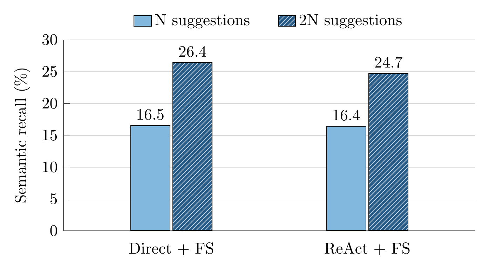
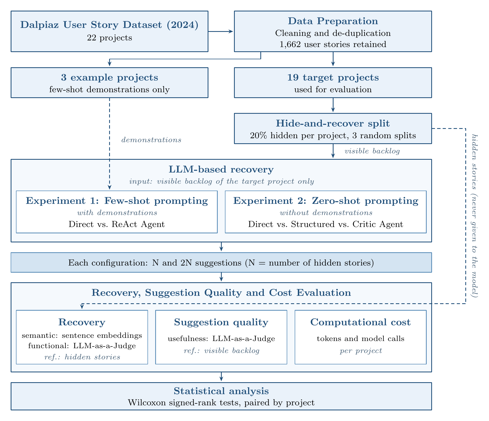
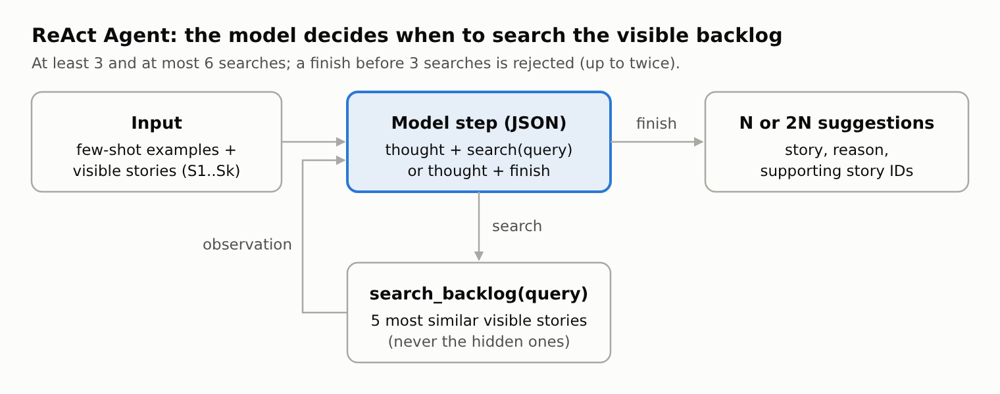

# LLM-Based Missing User Story Recovery: An Empirical Evaluation of Prompting Strategies

Course project for MSCS811 (Advanced Software Design and Development), Taibah University. Theme: adopting LLMs in software engineering within Agile and Extreme Programming.

Agile backlogs are often incomplete, and needs that nobody wrote down are found late. This project studies **LLM-based missing user story recovery**: given the visible part of a real backlog, how well can a large language model recover user stories that were intentionally omitted? Prompting strategy (including two agent-based methods) and suggestion budget are the experimental factors.

- **RQ1.** How effectively do different LLM prompting strategies recover intentionally omitted user stories?
- **RQ2.** How does increasing the suggestion budget affect recovery performance, suggestion quality, and computational cost?

**Main findings (19 test projects, 3 seeds, DeepSeek):**

1. **Recovery was limited**, and no statistically significant improvement in recall over Direct prompting was observed for the ReAct Agent (Experiment 1), or for Structured prompting and the Critic Agent (Experiment 2), at either budget. The strategies differed in suggestion characteristics: the Critic Agent removed near-copies of existing stories, and the ReAct Agent overlapped less with the backlog at 2N.
2. **Asking for twice as many suggestions (2N) raised recall in every configuration by 8 to 10 points** (p ≤ 0.0006). Precision fell and F1 showed no significant change. In Experiment 1 the overall share of suggestions judged useful was slightly higher in the 2N sets; the additional suggestions were not judged separately.



## Study design



**Hide and recover.** For every project, ⌊0.2 n + 0.5⌋ user stories are hidden (20% rounded half up), as whole units: groups of near-equivalent stories are hidden together. The model sees only the other 80%, with neutral IDs `S1..Sk`, and suggests the missing stories. The hidden stories never reach the model and are used only to score the suggestions. This is repeated with 3 random splits (seeds 1, 2, 3).

**Data.** The Dalpiaz user-story dataset: 22 real projects, 1,662 stories after cleaning. Projects g04, g13 and g25 supply the few-shot examples, so every comparison uses the other **19 test projects**.

**Model.** DeepSeek `deepseek-v4-pro`, temperature 0, for every method.

**Budget.** N = the number of hidden stories in the project. 2N = twice that.

### Methods

| Method | In the code | What it does | Calls per project |
|---|---|---|---|
| Direct | `direct` | Reads the visible stories and suggests the missing ones. Baseline. | 1 |
| Structured | `structured` | Extracts a table (role, function, object, conditions) first, then suggests. | 2 |
| Critic Agent | `agent` | Writes a draft; a tool flags any suggestion with similarity ≥ 0.85 to a visible story; the model replaces it (at most 2 rounds). | about 1.1 |
| Direct + Few-Shot | `direct` in `*_fs` files | Direct, with 3 worked examples from g04, g13 and g25. | 1 |
| ReAct Agent + Few-Shot | `react` | The same examples. At each step the model searches the visible backlog (`search_backlog`, top 5 stories) or finishes: at least 3 and at most 6 searches. | about 6 |



### Evaluation

| Measure | How it is computed |
|---|---|
| Semantic recall | Hidden stories matched by a suggestion with cosine similarity ≥ 0.60 (all-MiniLM-L6-v2), one-to-one greedy matching. The threshold was set before the experiments and never changed. |
| Precision, F1 | Matched suggestions / suggestions. At budget N, precision = recall = F1. |
| Functional recall | An LLM judge (Llama 3.3 70B via OpenRouter) decides for each hidden story whether a suggestion states the **same** need (strict) or **same or partly** (lenient). |
| Useful, novel | The same judge rates each suggestion against the visible stories only: relevant, novel and well-formed. Useful = all three. |
| Near-copy | Suggestions with similarity ≥ 0.85 to a visible story (lower is better). |
| Overlap | Suggestions with similarity ≥ 0.60 to a visible story. It also counts new needs from the same domain, so read it with care. |
| Cost | Model calls and tokens per project. |
| Statistics | Two-sided Wilcoxon signed-rank test, paired by project, seed-averaged, n = 19. |

Accuracy is not used: the task has no true negatives. Semantic matching and the LLM judge are complementary; neither is a perfect ground truth. Manual checks: on 60 pairs around the threshold, only 6 of 30 matches between 0.60 and 0.75 were the same need, and the judge agreed with the reference labels in 88.3% of pairs (Cohen's κ = 0.56); on 40 suggestions, novelty agreement was 77.5% (κ = 0.18). The reference labels were prepared with an LLM's assistance and reviewed by the author. LLM-as-a-Judge evaluation was conducted at N and 2N for Experiment 1, but only at N for Experiment 2.

## Results

All numbers are means over 3 seeds on the 19 test projects. Bold p-values are below 0.05.

### Experiment 1: few-shot prompting (Direct vs ReAct Agent)

| Measure | Direct, N | ReAct, N | Direct, 2N | ReAct, 2N |
|---|---|---|---|---|
| Semantic recall | 16.5% | 16.4% (p = 0.98) | 26.4% | 24.7% (p = 0.25) |
| Precision | 16.5% | 16.4% | 13.2% | 12.3% (p = 0.25) |
| F1 | 16.5% | 16.4% | 17.6% | 16.5% (p = 0.23) |
| Functional recall, strict | 6.6% | 6.8% (p = 0.73) | 14.1% | 12.8% (p = 0.53) |
| Functional recall, lenient | 18.2% | 19.4% (p = 0.21) | 31.4% | 28.9% (p = 0.12) |
| Useful (judge) | 93.0% | 93.7% (p = 0.43) | 95.3% | 96.6% (p = 0.06) |
| Overlap | 50.6% | 45.5% (p = 0.11) | 47.4% | 39.5% (**p = 0.0014**) |
| Near-copy | 1.1% | 1.5% (p = 0.63) | 1.0% | 0.5% (**p = 0.042**) |
| Calls per project | 1 | 6.3 | 1.02 | 5.96 |
| Tokens per project | 10,693 | 52,076 | 13,707 | 53,407 |

p-values compare ReAct with Direct at the same budget. No run failed. ReAct needed a format retry in 13 of 57 runs.

### Experiment 2: zero-shot prompting (Direct, Structured, Critic Agent)

| Measure | Direct | Structured | Critic Agent |
|---|---|---|---|
| Recall, budget N | 18.7% | 19.6% (p = 0.16) | 18.2% (p = 0.92) |
| Recall, budget 2N | 26.7% | 28.9% (p = 0.18) | 27.1% (p = 0.32) |
| F1, budget 2N | 17.8% | 19.3% (p = 0.23) | 18.0% (p = 0.32) |
| Useful (judge), budget N | 94.7% | 91.9% (**p = 0.021**) | 94.5% (p = 0.18) |
| Overlap, budget 2N | 44.2% | 53.3% (**p < 0.001**) | 46.9% (p = 0.11) |
| Near-copy, budget 2N | 0.6% | 1.1% (p = 0.15) | 0.0% (**p = 0.012**) |
| Tokens per project, budget N | 8,999 | 25,545 | 9,676 |

p-values compare each method with Direct at the same budget. The Critic Agent is compared with its own draft, which is Direct before the tool.

### Budget: 2N vs N for the same method

| Method | Recall | Precision | F1 |
|---|---|---|---|
| Direct | 18.7% → 26.7% (**p = 0.0003**) | 18.7% → 13.4% | 18.7% → 17.8% (p = 0.27) |
| Structured | 19.6% → 28.9% (**p = 0.0002**) | 19.6% → 14.5% | 19.6% → 19.3% (p = 0.30) |
| Critic Agent | 18.2% → 27.1% (**p = 0.0006**) | 18.2% → 13.5% | 18.2% → 18.0% (p = 0.86) |
| Direct + Few-Shot | 16.5% → 26.4% (**p = 0.0006**) | 16.5% → 13.2% | 16.5% → 17.6% (p = 0.41) |
| ReAct + Few-Shot | 16.4% → 24.7% (**p = 0.0002**) | 16.4% → 12.3% | 16.4% → 16.5% (p = 0.80) |

With the LLM judge (Experiment 1), 2N also raised functional recall (lenient: Direct 18.2% → 31.4%, p = 0.0002; ReAct 19.4% → 28.9%, p = 0.0007) and the share of useful suggestions (Direct 93.0% → 95.3%, p = 0.011; ReAct 93.7% → 96.6%, p = 0.013).

## Repository structure

```
llm.py              calls DeepSeek (key from the environment) and records tokens; offline fake models for tests
pipeline.py         the four methods: direct, structured, Critic Agent (agent), ReAct Agent (react)
run_experiment.py   runs the methods on every project for one seed; resumable
evaluate.py         semantic recall, precision, F1, overlap, near-copies, cost; Wilcoxon tests
judge.py            LLM judge: functional recall (strict and lenient)
judge_useful.py     LLM judge: relevant, novel, well-formed, useful
prepare_data.py     builds the clean dataset and the three splits from raw/ and review/
verify_data.py      independent checks of the data, the splits and the model inputs (no leakage)
raw/                the 22 original project files of the dataset
review/             manual decisions used to clean the data (continuation lines, duplicates, scope)
data/               clean stories, cleaning log, statistics, and the three splits
validation/         the 60 labelled pairs used to check the 0.60 threshold and the judge
results/            model outputs (JSON), judge caches, and all result tables (CSV)
figures/            the figures in this README
```

Result files are named `<run>_seed<n>.json`, where `<run>` is `deepseek`, plus `_k2` for budget 2N, `_fs` for few-shot, and `_agent` for the Critic Agent.

## How to run

```bash
pip install -r requirements.txt
cp .env.example .env        # then paste your own keys into .env; never commit it
```

Keys are read from environment variables, never from the code: `DEEPSEEK_API_KEY` for generation and `OPENROUTER_API_KEY` for the judge. In Colab, add them as Secrets.

```bash
# Experiment 1: few-shot (repeat for seeds 1, 2, 3; add --budget 2 for 2N)
python run_experiment.py deepseek 1 --fewshot --methods direct,react

# Experiment 2: zero-shot (repeat for seeds 1, 2, 3; add --budget 2 for 2N)
python run_experiment.py deepseek 1 --methods direct,structured
python run_experiment.py deepseek 1 --methods agent

# Evaluation and judges (the judges reuse the cached judgments in results/)
python evaluate.py
python judge.py
python judge_useful.py
```

To reproduce the tables without any API call, run `python evaluate.py`, `python judge.py --report` and `python judge_useful.py --report` on the saved files in `results/`. To test the whole pipeline offline, use the fake model: `python run_experiment.py mock 1`, then `python evaluate.py --test-tfidf`.

## Limitations

- One generation model (DeepSeek). A smaller open model was piloted but gave many invalid outputs, so it was not used.
- The 0.60 similarity threshold is lenient: in a manual check, only 6 of 30 matches between 0.60 and 0.75 were the same need. This is why the functional recall of the judge is reported too.
- Judge agreement is moderate for "same need" (κ = 0.56) and weak for novelty (κ = 0.18), so the usefulness rates are likely optimistic. The reference labels were prepared with an LLM's help and reviewed by the author.
- 19 test projects give the tests limited power. DeepSeek is not fully deterministic at temperature 0.
- The ReAct rule of at least 3 searches was added after a pilot run in which the model finished without searching.

## Data and citation

Dalpiaz, F. (2018, version 2: 2024). *Requirements data sets (user stories)*. Mendeley Data, V2. https://doi.org/10.17632/7zbk8zsd8y.2. License: CC BY 4.0. The files in `raw/` are from this dataset; `data/` is derived from them by `prepare_data.py`.
